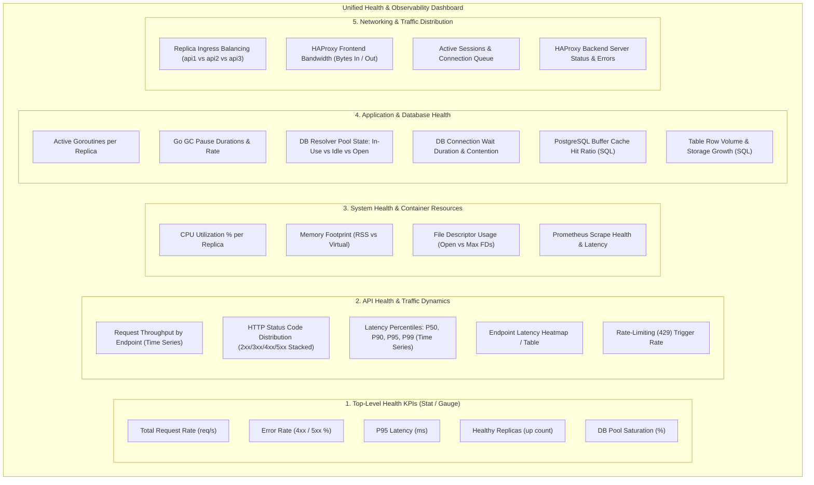

# Comprehensive Plan: Multi-Tier Health & Observability Dashboard in Grafana

## Goal Description
The objective is to examine the templates and current dashboard assets in the `grafana/` directory (specifically analyzing the sample `grafana/dashboards/10.20.2026/dash.json` alongside `nba_api_overview.json` and older iterations), and define an end-to-end strategy to build, configure, and provision a comprehensive production dashboard covering:
1. **API Health** (Throughput, error rates, latency percentiles, route breakdown, rate limiting)
2. **System Health** (Container/Process CPU, RSS memory footprint, file descriptors, target uptime)
3. **Application Health** (Go runtime goroutines, GC overhead, GORM connection pool saturation for read/write pools, PostgreSQL table analytics)
4. **Networking Health** (Cluster load balancing distribution across `api1`/`api2`/`api3`, HAProxy ingress metrics, network throughput)

---

## Analysis of Existing Grafana Directory & Assets

### 1. Data Sources Inventory (`grafana/provisioning/datasources/datasource.yml`)
The repository provisions three data sources:
| Data Source Name | UID | Type | Endpoint & Description |
| :--- | :--- | :--- | :--- |
| **Prometheus** | `PBFA97CFB590B2093` | `prometheus` | `http://prometheus:9090` (Internal docker network; default) |
| **PostgreSQL-Read-HA** | `afxrpob6lpnggc` | `grafana-postgresql-datasource` | `178.105.149.129:5438` (HAProxy load-balanced read replicas, `appdb`) |
| **PostgreSQL-Write-HA** | `efxrponpevy0wc` | `grafana-postgresql-datasource` | `178.105.149.129:5437` (Primary PostgreSQL instance, `appdb`) |

### 2. Dashboard Template Evolution
- **`grafana/dashboards/10.20.2026/dash.json`** (Sample from 10/20/2026):
  - Uses the **Grafana Scenes Declarative Schema v2** (`apiVersion: "dashboard.grafana.app/v2"`, `kind: "Dashboard"`).
  - Uses modern `elements` mapping and `GridLayout` items rather than legacy `panels` arrays.
  - Queries Prometheus (`PBFA97CFB590B2093`) with `sum(rate(prometheus_http_requests_total{}[$__rate_interval]))`.
- **`grafana/dashboards/nba_api_overview.json`**:
  - Uses traditional Grafana schema (`panels` array, `schemaVersion: 39`, `pluginVersion: 11.6.1`).
  - Contains rich sections for KPIs, HTTP traffic, latency quantiles, container load balancing, and PostgreSQL table/buffer queries.
- **`grafana/dashboards/latest/*.json`**:
  - Older snapshots capturing specific test metrics and manual panel experiments.

### 3. Provisioning Architecture & Gotchas
- **Provisioning file**: `grafana/provisioning/dashboards/dashboard.yml` instructs Grafana to scan `/var/lib/grafana/dashboards`.
- **Docker gotcha**: In `docker-compose.yml`, `grafana_data:/var/lib/grafana` mounts a named volume over `/var/lib/grafana`. When a persistent Docker named volume exists, updates to files inside `grafana/dashboards/` baked into the Docker image may be shadowed by the volume's existing state.
  > [!IMPORTANT]
  > To ensure live reload during development and reliable provisioning in production, dashboards should either be bind-mounted (e.g. `./grafana/dashboards:/etc/grafana/provisioning/dashboards/json_dashboards:ro`) or the provider configuration updated to target `/etc/grafana/provisioning/dashboards/definitions`.

---

## Available Metrics & Telemetry Catalog

### Prometheus Metrics Scraped from `nba-api` (`api1:5000`, `api2:5000`, `api3:5000`)
1. **Custom HTTP Telemetry** (`utils/metrics/metrics.go`):
   - `nba_http_requests_total{method, endpoint, status}`: Counter of all requests processed.
   - `nba_http_request_duration_seconds{method, endpoint}`: Histogram with latency buckets `[0.005, 0.01, 0.025, 0.05, 0.1, 0.25, 0.5, 1, 2.5, 5, 10]`.
2. **Database Pool Telemetry** (GORM DBResolver Stats polled every 5s):
   - `nba_db_pool_open_connections{pool="read"|"write"}`
   - `nba_db_pool_in_use_connections{pool="read"|"write"}`
   - `nba_db_pool_idle_connections{pool="read"|"write"}`
   - `nba_db_pool_wait_count_total{pool="read"|"write"}`
   - `nba_db_pool_wait_duration_seconds_total{pool="read"|"write"}`
   - `nba_db_operations_total{operation, entity}`
3. **Go Runtime Telemetry** (Default Go collector):
   - `go_goroutines`: Active concurrent goroutines.
   - `go_memstats_alloc_bytes`: Current bytes allocated on heap.
   - `go_memstats_sys_bytes`: Total memory obtained from OS.
   - `go_gc_duration_seconds`: Garbage collection pause duration percentiles.
4. **Process / System Telemetry** (Default Process collector):
   - `process_cpu_seconds_total`: Total user and system CPU time.
   - `process_resident_memory_bytes`: Physical RAM footprint (RSS).
   - `process_virtual_memory_bytes`: Virtual memory size.
   - `process_open_fds` / `process_max_fds`: Socket/file descriptor limits.
5. **HAProxy Telemetry** (`178.105.149.129:7080/metrics`):
   - `haproxy_frontend_bytes_in_total`, `haproxy_frontend_bytes_out_total`
   - `haproxy_frontend_current_sessions`, `haproxy_backend_current_sessions`
   - `haproxy_server_status` (Health of backend DB / API nodes)
   - `haproxy_backend_connection_errors_total`

### Direct PostgreSQL Queries (`PostgreSQL-Read-HA` / `PostgreSQL-Write-HA`)
- **Connection Counts**: `SELECT count(*), state FROM pg_stat_activity GROUP BY state;`
- **Cache Hit Ratio**: `SELECT sum(heap_blks_hit) / nullif(sum(heap_blks_hit) + sum(heap_blks_read), 0) * 100 AS buffer_cache_hit_ratio FROM pg_statio_user_tables;`
- **Table Sizes & Row Counts**: `SELECT relname AS table_name, n_live_tup AS row_count, pg_size_pretty(pg_total_relation_size(relid)) AS total_size FROM pg_stat_user_tables ORDER BY pg_total_relation_size(relid) DESC LIMIT 10;`
- **Transaction Rate**: `SELECT xact_commit, xact_rollback FROM pg_stat_database WHERE datname = 'appdb';`

---

## Target Dashboard Architecture



---

## Detailed Metric Formulas & Panel Definitions

### Tier 1: API Health
1. **Total Request Rate**:
   - Query: `sum(rate(nba_http_requests_total[$__rate_interval])) or vector(0)`
   - Unit: `reqps`
2. **Error Rate Percentage (4xx / 5xx)**:
   - 5xx (Server Errors): `(sum(rate(nba_http_requests_total{status=~"5.."}[$__rate_interval])) or vector(0)) / (sum(rate(nba_http_requests_total[$__rate_interval])) or vector(1)) * 100`
   - 4xx (Client Errors): `(sum(rate(nba_http_requests_total{status=~"4.."}[$__rate_interval])) or vector(0)) / (sum(rate(nba_http_requests_total[$__rate_interval])) or vector(1)) * 100`
   - Thresholds: Yellow > 1%, Red > 5%
3. **Latency Percentiles (Global)**:
   - P50: `histogram_quantile(0.50, sum by (le) (rate(nba_http_request_duration_seconds_bucket[$__rate_interval]))) * 1000`
   - P90: `histogram_quantile(0.90, sum by (le) (rate(nba_http_request_duration_seconds_bucket[$__rate_interval]))) * 1000`
   - P95: `histogram_quantile(0.95, sum by (le) (rate(nba_http_request_duration_seconds_bucket[$__rate_interval]))) * 1000`
   - P99: `histogram_quantile(0.99, sum by (le) (rate(nba_http_request_duration_seconds_bucket[$__rate_interval]))) * 1000`
   - Unit: `ms` (milliseconds)
4. **Traffic Breakdown by Endpoint**:
   - Query: `sum by (endpoint) (rate(nba_http_requests_total{endpoint=~"$endpoint"}[$__rate_interval]))`
5. **Rate Limiting Events (HTTP 429)**:
   - Query: `sum by (endpoint) (rate(nba_http_requests_total{status="429"}[$__rate_interval])) or vector(0)`

### Tier 2: System Health
1. **CPU Utilization % per Node**:
   - Query: `rate(process_cpu_seconds_total{instance=~"$instance"}[$__rate_interval]) * 100`
   - Unit: `percent (0-100)`
2. **Memory Footprint (Resident Set Size)**:
   - Query: `process_resident_memory_bytes{instance=~"$instance"}`
   - Unit: `bytes` (IEC / metric)
3. **Open File Descriptors vs Limits**:
   - Query A: `process_open_fds{instance=~"$instance"}`
   - Query B: `process_max_fds{instance=~"$instance"}`
   - Visualization: Time series with fill area or gauge
4. **Instance Uptime & Target Status**:
   - Query: `up{job="nba-api"}`
   - Value mappings: `1` -> UP (Green), `0` -> DOWN (Red)

### Tier 3: Application & Database Health
1. **Go Goroutines**:
   - Query: `go_goroutines{instance=~"$instance"}`
   - Detects goroutine leaks or concurrency spikes during heavy scrapers or slow database queries.
2. **GC Pause Duration**:
   - Query: `rate(go_gc_duration_seconds_sum[$__rate_interval]) / rate(go_gc_duration_seconds_count[$__rate_interval]) * 1000`
   - Unit: `ms`
3. **Database Connection Pool Utilization**:
   - In-Use vs Idle vs Open:
     - In-Use: `sum by (pool) (nba_db_pool_in_use_connections)`
     - Open: `sum by (pool) (nba_db_pool_open_connections)`
     - Idle: `sum by (pool) (nba_db_pool_idle_connections)`
4. **Connection Pool Contention / Wait Events**:
   - Wait Rate: `sum by (pool) (rate(nba_db_pool_wait_count_total[$__rate_interval]))`
   - Wait Duration: `sum by (pool) (rate(nba_db_pool_wait_duration_seconds_total[$__rate_interval]))`
5. **Direct PostgreSQL Analytics (via `PostgreSQL-Read-HA`)**:
   - Active Connections:
     ```sql
     SELECT state, count(*) FROM pg_stat_activity WHERE datname = 'appdb' GROUP BY state;
     ```
   - Buffer Cache Hit Ratio:
     ```sql
     SELECT sum(heap_blks_hit) / nullif(sum(heap_blks_hit) + sum(heap_blks_read), 0)::float * 100 AS cache_hit_ratio FROM pg_statio_user_tables;
     ```
   - Top Table Row Counts:
     ```sql
     SELECT relname AS table_name, n_live_tup AS rows FROM pg_stat_user_tables ORDER BY n_live_tup DESC LIMIT 10;
     ```

### Tier 4: Networking Health
1. **Load Balancer Request Distribution**:
   - Query: `sum by (instance) (rate(nba_http_requests_total{instance=~"$instance"}[$__rate_interval]))`
   - Validates that NGINX is evenly balancing load across `api1`, `api2`, and `api3`.
2. **HAProxy Bandwidth Throughput**:
   - Network In: `sum(rate(haproxy_frontend_bytes_in_total[$__rate_interval]))`
   - Network Out: `sum(rate(haproxy_frontend_bytes_out_total[$__rate_interval]))`
   - Unit: `Bps` (Bytes/sec)
3. **HAProxy Connection Sessions**:
   - Active Frontend Sessions: `sum(haproxy_frontend_current_sessions)`
   - Active Backend Sessions: `sum(haproxy_backend_current_sessions)`
   - Error Rate: `sum(rate(haproxy_backend_connection_errors_total[$__rate_interval]))`

---

## Dashboard Schema Architecture: Choosing Format

Grafana supports two JSON structures:
1. **Standard Grafana JSON (`panels: [...]`, Universal)**:
   - Backwards and forwards compatible across all Grafana versions (9, 10, 11, 12).
   - Readily managed by Grafana's file provisioning provider.
   - Used in `nba_api_overview.json`.
2. **Scenes Declarative v2 Schema (`apiVersion: "dashboard.grafana.app/v2"`)**:
   - Native to Grafana 11+ UI exports (as seen in `grafana/dashboards/10.20.2026/dash.json`).
   - Organized into `elements` dictionary and `GridLayout`.

> [!TIP]
> We can either modernize `nba_api_overview.json` by adding the missing networking and system panels, or compile a complete, unified declarative dashboard matching `10.20.2026/dash.json`. The standard schema is recommended for provisioning stability across all environments.

---

## Verification Plan

### Automated / Scrape Verification
1. Verify Prometheus endpoint accessibility and metric export:
   ```bash
   curl -s http://localhost:5000/metrics | grep -E "nba_http_|nba_db_pool_|go_goroutines|process_cpu"
   ```
2. Verify Prometheus scraping status for all jobs (`nba-api`, `haproxy`):
   ```bash
   curl -s http://localhost:9091/api/v1/targets | jq '.data.activeTargets[] | {job: .labels.job, instance: .labels.instance, health: .health}'
   ```
3. Verify Grafana datasource connectivity via Grafana HTTP API:
   ```bash
   curl -s -u admin:testing http://localhost:3001/api/datasources
   ```

### Manual Verification
1. Open Grafana at `http://localhost:3001` (login: `admin` / `testing`).
2. Run load test generator:
   ```bash
   go run ./test/loadtest.go -url 'http://localhost:8081/api/playeradvancedstats' -n 500 -c 10 -varyParams
   ```
3. Confirm in the dashboard:
   - Request rate spikes accordingly.
   - P95 latency reflects origin response times.
   - Load distribution shows balanced spikes across `api1`, `api2`, and `api3`.
   - DB connection pool shows active in-use connections.
   - PostgreSQL table stats and buffer cache panels render data.
